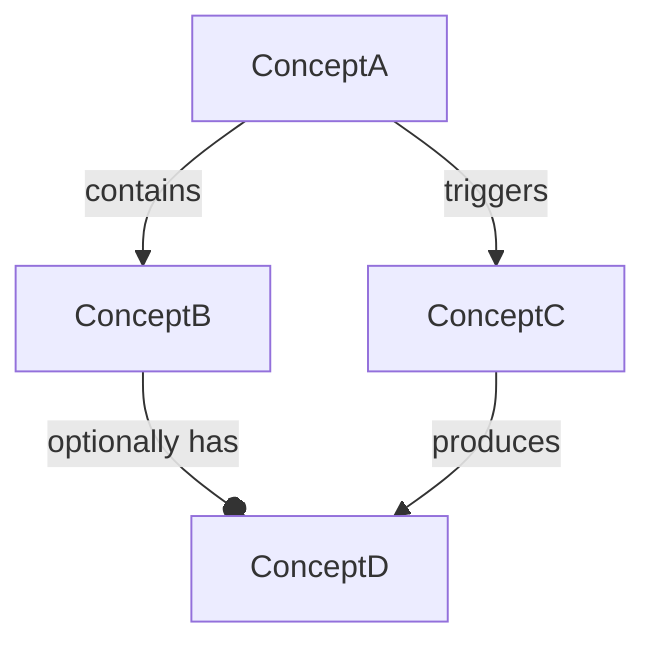

# Align Understanding

Shared language is a prerequisite for shared plans. This skill establishes it before
any design or implementation work begins.

## Why This Matters

Three traditions inform this skill:

**DDD Ubiquitous Language** — Domain experts and engineers share a single vocabulary.
Terms appear consistently in code, docs, tickets, and conversation. Ambiguity in language
produces bugs; inconsistency produces integration failures.

**Conceptual Engineering (Cappelen)** — Concepts we inherit are often defective: vague,
contested, borrowed from a context where they mean something different. The response is
not to accept the concept and define it — it's to examine whether the concept is the
right one, and revise it if not. "Should we be using this word at all?" is a legitimate
question at this stage.

**Concept Design (Jackson)** — Core design concepts have structure: a name, a purpose
(the user need they serve), states they can be in, and actions that operate on them.
Defining concepts this way surfaces hidden assumptions and reveals when two people are
using the same word for different things.

## When to Use

Stage 2 of `start-task`. Do not skip. Misaligned vocabulary is the most common source
of wrong plans.

---

## Phase 1 — Term Discovery

Read `context.md` and `artifacts/context-gathered.md` (if it exists).

Extract every domain term — nouns and noun phrases that name something in the problem space. Include:

- Terms the user used in the task description
- Terms that appeared in Jira tickets, PR descriptions, or code
- Terms that name system components, user actions, data entities, or states

Flag terms that are:
- **Undefined** — used but never described
- **Polysemous** — the same word used in multiple distinct ways in the sources
- **Borrowed** — taken from a related domain where it may carry different meaning
- **Contested** — different sources use conflicting definitions

Present the list to the user. Ask: "Are there terms we're using that I missed? Any you'd remove?"

---

## Phase 2 — Conceptual Engineering

For each flagged term, work through:

1. **Current use**: "In the sources, this term is used to mean X, and sometimes Y."
2. **Diagnosis**: What's wrong? (Too broad? Borrowed meaning? Conflated with another concept?)
3. **Proposal**: A revised or replacement term with a precise definition for this context.
4. **Check**: "Does this definition hold in the edge cases? What would it mean to say [edge case]?"

Do not stop at "let's define it." Ask whether the concept itself should be revised or replaced.
If "service" has been overloaded by five different teams to mean five things, it may be
better to use "adapter", "handler", "processor", or "orchestrator" — terms that carry less
baggage — than to define yet another shade of "service."

State proposals explicitly: "I'd propose we use `<term>` to mean `<definition>` for this task.
Does that feel right, or does it miss something?"

---

## Phase 3 — Concept Design

For the core design concepts — the ones that will appear in code, APIs, and the plan — define them structurally using Jackson's model:

```
**Concept: <Name>**

Purpose: <The user need this concept serves. One sentence. Starts with a verb: "Lets users...", "Allows the system to...">

Principal type: <The primary entity this concept acts on>

States:
- <state name>: <what it means>

Actions:
- <action(args)>: <what it does to the state>

Operational principle: After <action>, <observable consequence>.

Distinct from: <nearby concept it might be confused with, and how it differs>
```

Not every term needs full concept design — only the ones that will shape the architecture
or appear in the plan. Use judgment. Two or three deeply defined concepts beat ten shallow ones.

---

## Phase 4 — Agreement

Present the proposed glossary entries for review. For each:

- Ask: "Does this match your mental model?"
- Ask: "Is there a scenario where this definition would give the wrong answer?"
- Ask: "Is there a better term for this?"

Do not proceed until the user confirms each definition or proposes a revision.
If a definition is revised, update it and ask again.

The glossary is the ground truth for the rest of the task. If a term's meaning shifts
later, come back here and update it — don't let two definitions coexist.

---

## Phase 5 — Artifact Creation

### Glossary (`artifacts/glossary.md`)

```markdown
# Glossary

*Terms used in this task and their agreed definitions. Update as understanding evolves.*

---

## <Term>

**Definition:** <agreed definition, one or two sentences>

**Examples:** <concrete instances that are clearly in scope>

**Non-examples:** <instances that might seem in scope but are not>

**Related terms:** <other glossary terms this connects to, with the nature of the relationship>

**Distinct from:** <a nearby concept it could be confused with>

---
```

### Concept Map (`artifacts/concept-map.md`)

Produce a mermaid diagram showing the relationships between the core concepts.
Relationship types to use:

- `-->` has / contains
- `--o` optionally has
- `<-->` bidirectional relationship (use sparingly; usually asymmetry is real)
- Label the arrow with the relationship name

```markdown
# Concept Map



*Relationships: [brief legend if arrows need explanation]*
```

Both files are written to `artifacts/` and persist for the rest of the task. The user can
open them in any markdown viewer that renders mermaid.

---

## Validation

Before declaring this stage complete, run this check:

Write one sentence that describes the task using only glossary terms. If the sentence
requires a word that isn't in the glossary, that word probably needs to be there.

Example: *"The `Ingestion Pipeline` receives `Events` from `Producers` and routes them
to the appropriate `Handler` based on `Event Type`."*

If the sentence feels strained or requires hedging, the vocabulary isn't settled yet.
