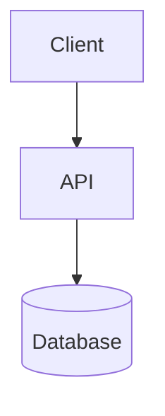

# Task

Sets up an isolated git worktree — or, outside a git repo, a plain task directory — plus a
`.task/` record that holds every document pertaining to the task. This is the durable
record for the task, not Claude's memory: any new session (yours or another) must be able
to pick up the task from these files alone, and a human must be able to audit them without
any tool.

`.task/` splits by audience:

- **`CONTEXT.md`, `PROGRESS.md`, `DECISIONS.md`** — the audit trail. Write these plainly —
  run drafts through `writing-for-humans` before saving. Never let raw reasoning, dead
  ends, or working notes leak into them; that goes in `SCRATCHPAD.md` instead.
  - **`CONTEXT.md`** — what the task is: ticket summary, key files, links, constraints. Read this first to get oriented.
  - **`PROGRESS.md`** — a todo list: what's done, what's current, what's next. Completed items stay, never deleted — it's the record of how the task moved, not just its state.
  - **`DECISIONS.md`** — an append-only decision log: what was decided and why, in the style of a lightweight ADR. Never edit or delete a past entry; if a decision is reversed, add a new entry that says so.

  A subtask with real weight of its own gets its own `CONTEXT.md`/`DECISIONS.md` under
  `subtasks/<slug>/` (see Maintaining, below) — so reviewing one piece of the plan doesn't
  require reading the whole task.

  Reach for a Mermaid diagram in `CONTEXT.md` or a `DECISIONS.md` entry any time it'll show
  architecture, flow, or the relationship between files or components more clearly than
  prose would (syntax in Reference) — it renders in most markdown viewers and still reads
  fine as plain text otherwise, no tool required, same as everything else in `.task/`.
- **`SCRATCHPAD.md`** — your working notes, for you. Whatever format is fastest to think
  in — fragments, dense shorthand, half-formed hypotheses, dead ends. No `writing-for-humans`
  pass, no obligation to be tidy or even correct. Don't move things out of it into the other
  three unless they've become a real fact, a real decision, or a real status change.

Invoking this skill registers a `Stop` hook (in frontmatter above) for the rest of the
session. It checks `.task/` at the *current* cwd on every turn — silent the moment you're
not inside a task directory — and, when one exists, adds a reminder as context you see:
consider whether `CONTEXT.md`, `PROGRESS.md`, or `DECISIONS.md` need updating for what just
happened. It fires once per turn, not repeatedly within one — it recognizes its own
re-invocations and stands down rather than re-nudging.

## Steps

1. **Derive the slug and branch name** from the invocation argument.
   - Ticket-shaped (`[A-Za-z]+-[0-9]+`, e.g. `pip-42`, `PIP-42`): uppercase it for the slug and branch — `PIP-42` — regardless of the case given.
   - Free-text description, no ticket: compress it to a short kebab-case slug, 2–4 words, that still reads as the task — not a full slugified sentence (e.g. "fix the bug where login redirects to the wrong page after SSO" → `fix-login-redirect`).
   - No argument: ask what the task is before continuing.

   Branch name is always `feature/<slug>`.

2. **Determine the task root.** Try `git rev-parse --show-toplevel`.
   - **Git repo** — root is its output. Task root will be `<root>/.worktrees/<slug>`.
     - **Ensure `.worktrees/` and `.task/` are ignored:** check `<root>/.git/info/exclude`; append either pattern that's missing. This file is shared by every worktree of the repo and isn't tracked, so it needs no commit and doesn't touch the team's `.gitignore`.
   - **No git repo** — task root will be `~/.claude/tasks/<slug>`. There's no worktree, branch, or diff to isolate, so skip straight to step 4.

3. **Check for a pre-existing task** at the task root. If it's already there, report its path (and branch, if any) and stop — do not recreate or modify it, and do not overwrite its `.task/`.

4. **Set up the task root.**
   - **Git repo:** create the worktree, branching from current `HEAD`:
     ```
     git worktree add -b feature/<slug> <root>/.worktrees/<slug>
     ```
     If that fails because `feature/<slug>` already exists (e.g. the worktree was removed earlier but the branch survived), attach the worktree to the existing branch instead:
     ```
     git worktree add <root>/.worktrees/<slug> feature/<slug>
     ```
   - **No git repo:** `mkdir -p ~/.claude/tasks/<slug>`.

5. **Create `.task/CONTEXT.md`, `PROGRESS.md`, `DECISIONS.md`, and `SCRATCHPAD.md`** inside the task root (templates below). Populate `CONTEXT.md` from whatever is known now — ticket ID, the user's own description, nothing invented; omit the `Branch`/`Worktree` fields (or mark them `none`) when there's no git repo. `PROGRESS.md` starts with a single Current entry; `DECISIONS.md` and `SCRATCHPAD.md` start empty — don't invent a first decision or note.

6. **Report** the task root (plus branch name, if any), then switch into it (`cd`) for the rest of the session.

## Completion criterion

The task root exists — a worktree on `feature/<slug>` (new or reattached) inside a git repo, or a plain directory at `~/.claude/tasks/<slug>` otherwise — all four of `.task/{CONTEXT,PROGRESS,DECISIONS,SCRATCHPAD}.md` exist inside it, and the user has been told where it is.

## Maintaining `.task/` after setup

This is the task's memory — not the assistant's. Every session working in this task root, including this one, keeps it current:

- **CONTEXT.md** — update whenever a new fact worth resuming from surfaces: a file that turned out to matter, a constraint discovered mid-task, a linked ticket. Edit in place; it describes current understanding, not history.
- **PROGRESS.md** — move items between Todo / Current / Done as work actually moves. Never delete a Done entry. When a Todo or Current item turns out to have real steps, break it into subtasks: nested `- [ ]` lines under it, added as soon as the breakdown is known rather than after the fact. Check off each subtask independently as it's done; the parent only moves to Done once every subtask under it is checked. PROGRESS.md stays the one place to see status for all of them — that doesn't change.
- **Subtask docs** — when a subtask accumulates enough of its own context or decisions that burying them in the parent's `CONTEXT.md`/`DECISIONS.md` would make either harder to review, give it `.task/subtasks/<subtask-slug>/CONTEXT.md` and `DECISIONS.md` (same format and rules as the parent's, scoped to just that subtask) and link them from its PROGRESS.md line. Most subtasks don't need this — it's for the ones with real weight, so a person picking up just that piece can read its own docs instead of the whole task's.
- **DECISIONS.md** — append a new entry the moment a real decision gets made (a choice between approaches, a tradeoff accepted, a constraint that shaped the plan) — not for routine steps that only have one reasonable way to do them.
- **SCRATCHPAD.md** — write to it freely, any time thinking-out-loud helps: exploring an approach, working through why something broke, listing options before picking one. This is not read for audit; the other three are. If something there turns out to matter for resuming or auditing the task, promote it into `CONTEXT.md`, `PROGRESS.md`, or `DECISIONS.md` — don't leave the audit trail depending on the scratchpad.
- In a git repo, `.task/` is ignored via `.git/info/exclude`, so it never pollutes the branch's diff. Outside a git repo there's no diff to pollute. Either way it stays on disk for the life of the task — open the files directly, no tooling required.

## Listing ongoing tasks

Task roots live in two places that don't show up in a normal directory listing — check both:

- **This repo's worktrees**, if in a git repo: `git worktree list`, cross-referenced against `<root>/.worktrees/`.
- **Fallback tasks**, always, regardless of cwd — these are global, not tied to any repo: `ls ~/.claude/tasks/`.

This is the only way to see fallback tasks at all outside a git repo — they don't live anywhere the user would otherwise think to look. For each task root found, read `.task/PROGRESS.md`'s Current entry (and `CONTEXT.md`'s Summary if more detail helps) so the answer is a one-line status per task, not a bare list of directory names.

## Reference

### CONTEXT.md template

```markdown
# Context

**Ticket:** <ID and link, if any>
**Branch:** feature/<slug> — or `none` outside a git repo
**Worktree:** <root>/.worktrees/<slug> — or `none` outside a git repo
**Started:** <date>

## Summary
<the task as given — ticket summary or the user's own description>

## Key Files
- <path> — <why it matters>

## Notes
<constraints, related work, anything else needed to resume cold>
```

### PROGRESS.md template

```markdown
# Progress

## Current
- [ ] Task started — not yet planned

## Todo
(none yet)

## Done
(nothing yet)
```

A Todo or Current item broken into subtasks, nested one level under it:

```markdown
## Current
- [ ] Add retry logic to job queue
  - [x] Identify all call sites
  - [ ] Add backoff config
  - [ ] Update tests
```

A subtask with its own docs, linked from its line:

```markdown
## Current
- [ ] Add retry logic to job queue — see [subtasks/retry-logic/](subtasks/retry-logic/CONTEXT.md)
  - [x] Identify all call sites
  - [ ] Add backoff config
  - [ ] Update tests
```

### subtasks/\<slug\>/ (as needed)

Same rules and format as the parent's — `CONTEXT.md` and `DECISIONS.md` only, scoped to
that subtask. Use the same templates as the parent's (this Reference section), just
narrower in scope. No `PROGRESS.md` or `SCRATCHPAD.md` here: status stays in the parent's
`PROGRESS.md`, and scratch thinking stays in the parent's `SCRATCHPAD.md`, so there's still
exactly one place to check either.

### DECISIONS.md template

```markdown
# Decisions

<!-- One entry per decision, oldest first. Never edit a past entry — append a new one if reversed. -->
```

Each entry, once a decision is made:

```markdown
## <date> — <what was being decided>
**Decision:** <what was chosen>
**Reasoning:** <why — the factors that made it the right call>
**Alternatives considered:** <other options and why not, if any>
```

### SCRATCHPAD.md template

```markdown
# Scratchpad

<!-- Yours. No format required — write however is fastest to think in. -->
```

### Diagrams

A fenced `mermaid` block, dropped directly into `CONTEXT.md` or a `DECISIONS.md` entry:

````markdown

````
