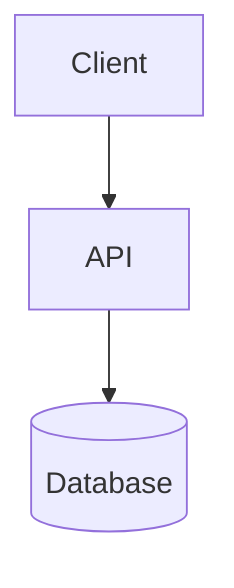

# Task

Sets up an isolated git worktree (in a git repo) plus a record at `~/tasks/<slug>/` that holds
every document pertaining to the task. The record lives outside the workspace, so removing the
worktree doesn't destroy it. This is the durable record for the task, not Codex's memory: any
new session (yours or another) must be able
to pick up the task from these files alone, and a human must be able to audit them without
any tool.

These documents are artifacts: the primary way to capture and share information with the
user, not just an internal log written for a future session. Markdown files and Mermaid diagrams
are the default, but reach for whatever format communicates best — a table, an ASCII sketch,
an exported data file, anything else useful — rather than forcing everything into prose.

Most tasks are coding-adjacent enough to also warrant `software-design-philosophy` (code-shape
decisions) and `solution-design-practice` (the design work before code exists — problem
statements, decision matrices). Consider both when starting a task; skip only when the task is
clearly outside their scope.

The record splits by audience:

- **`CONTEXT.md`, `PROGRESS.md`, `DECISIONS.md`** — the audit trail. Write these plainly —
  run drafts through `writing-for-humans` before saving. Never let raw reasoning, dead
  ends, or working notes leak into them; that goes in `SCRATCHPAD.md` instead.
  - **`CONTEXT.md`** — what the task is: ticket summary, key files, links, constraints, and —
    when the problem isn't already obvious from the ticket — a problem statement (see
    `solution-design-practice`). Read this first to get oriented.
  - **`PROGRESS.md`** — a todo list: what's done, what's current, what's next. Completed items stay, never deleted — it's the record of how the task moved, not just its state.
  - **`DECISIONS.md`** — an append-only decision log: what was decided and why, in the style of a lightweight ADR. Never edit or delete a past entry; if a decision is reversed, add a new entry that says so.
  - **`GLOSSARY.md`** (optional, ad hoc) — not one of the four created at setup. Add it later,
    directly in `~/tasks/<slug>/`, only once the task's vocabulary is actually ambiguous enough
    to need it (see `solution-design-practice`). One definition per term, in one place; no
    fixed template. Fix or drop an entry the moment it stops fitting rather than let it go stale.

  A subtask with real weight of its own gets its own `CONTEXT.md`/`DECISIONS.md` under
  `subtasks/<slug>/` (see Maintaining, below) — so reviewing one piece of the plan doesn't
  require reading the whole task.

  Reach for a Mermaid diagram in `CONTEXT.md` or a `DECISIONS.md` entry any time it'll show
  architecture, flow, or the relationship between files or components more clearly than
  prose would (syntax in Reference) — it renders in most markdown viewers and still reads
  fine as plain text otherwise, no tool required, same as everything else in the record.
- **`SCRATCHPAD.md`** — your working notes, for you. Whatever format is fastest to think
  in — fragments, dense shorthand, half-formed hypotheses, dead ends. No `writing-for-humans`
  pass, no obligation to be tidy or even correct. Don't move things out of it into the other
  three unless they've become a real fact, a real decision, or a real status change.

At the end of every turn spent working on a task, check whether `CONTEXT.md`, `PROGRESS.md`, or `DECISIONS.md` in `~/tasks/<slug>/` needs an update based on what just happened. If an update is needed, make it before ending the turn. Treat the diff as the record; do not add a separate summary solely for the task files.

## Steps

1. **Derive the slug and branch name** from the invocation argument.
   - Ticket-shaped (`[A-Za-z]+-[0-9]+`, e.g. `pip-42`, `PIP-42`): uppercase it for the slug and branch — `PIP-42` — regardless of the case given.
   - Free-text description, no ticket: compress it to a short kebab-case slug, 2–4 words, that still reads as the task — not a full slugified sentence (e.g. "fix the bug where login redirects to the wrong page after SSO" → `fix-login-redirect`).
   - No argument: ask what the task is before continuing.

   Branch name is always `feature/<slug>`.

2. **Locate the workspace.** Try `git rev-parse --show-toplevel`.
   - **Git repo** — root is its output. The worktree will be `<root>/.worktrees/<slug>`.
     - **Ensure `.worktrees/` and `.task` are ignored:** check `<root>/.git/info/exclude`; append either pattern that's missing, and replace an existing `.task/` line (from older versions of this skill) with `.task`. This file is shared by every worktree of the repo and isn't tracked, so it needs no commit and doesn't touch the team's `.gitignore`. Write `.task` with no trailing slash: a trailing slash matches only directories, so the `.task` symlink would show as untracked and block `git worktree remove`.
   - **No git repo** — there's no worktree, branch, or diff to isolate. Only the record is created; make nothing in the current directory and don't `cd`.

3. **Check for a pre-existing task** at `~/tasks/<slug>/`. If it's there, resume it instead of creating anything: in a git repo, if the worktree is missing, recreate it with the existing-branch form in step 4 and re-create the `.task` symlink, then `cd` into it; report the record path (plus branch and worktree, if any) and stop. Never overwrite existing record files.

4. **Set up the record and workspace.** `mkdir -p ~/tasks/<slug>`. Then, in a git repo, create the worktree, branching from current `HEAD`:
   ```
   git worktree add -b feature/<slug> <root>/.worktrees/<slug>
   ```
   If that fails because `feature/<slug>` already exists (e.g. the worktree was removed earlier but the branch survived), attach the worktree to the existing branch instead:
   ```
   git worktree add <root>/.worktrees/<slug> feature/<slug>
   ```
   Then symlink the record into it:
   ```
   ln -s ~/tasks/<slug> <root>/.worktrees/<slug>/.task
   ```

5. **Create `CONTEXT.md`, `PROGRESS.md`, `DECISIONS.md`, and `SCRATCHPAD.md`** in `~/tasks/<slug>/` (templates below). Populate `CONTEXT.md` from whatever is known now — ticket ID, the user's own description, nothing invented; set `Location` to the repo root or current directory, mark `Branch`/`Worktree` as `none` when there's no git repo, and omit the Problem Statement section unless the task's problem isn't already clear from the ticket. `PROGRESS.md` starts with a single Current entry; `DECISIONS.md` and `SCRATCHPAD.md` start empty — don't invent a first decision or note.

6. **Report** the record path (plus branch and worktree, if any). In a git repo, `cd` into the worktree for the rest of the session.

## Completion criterion

`~/tasks/<slug>/` exists with all four of `{CONTEXT,PROGRESS,DECISIONS,SCRATCHPAD}.md`; in a git repo, a worktree on `feature/<slug>` (new or reattached) exists with `.task` symlinked to the record; and the user has been told where they are.

## Maintaining the record after setup

This is the task's memory — not the assistant's. Every session working on this task, including this one, keeps it current:

- **CONTEXT.md** — update whenever a new fact worth resuming from surfaces: a file that turned out to matter, a constraint discovered mid-task, a linked ticket. Edit in place; it describes current understanding, not history.
- **PROGRESS.md** — move items between Todo / Current / Done as work actually moves. Never delete a Done entry. When a Todo or Current item turns out to have real steps, break it into subtasks: nested `- [ ]` lines under it, added as soon as the breakdown is known rather than after the fact. Check off each subtask independently as it's done; the parent only moves to Done once every subtask under it is checked. PROGRESS.md stays the one place to see status for all of them — that doesn't change.
- **Subtask docs** — when a subtask accumulates enough of its own context or decisions that burying them in the parent's `CONTEXT.md`/`DECISIONS.md` would make either harder to review, give it `subtasks/<subtask-slug>/CONTEXT.md` and `DECISIONS.md` (same format and rules as the parent's, scoped to just that subtask) and link them from its PROGRESS.md line. Most subtasks don't need this — it's for the ones with real weight, so a person picking up just that piece can read its own docs instead of the whole task's.
- **DECISIONS.md** — append a new entry the moment a real decision gets made (a choice between approaches, a tradeoff accepted, a constraint that shaped the plan) — not for routine steps that only have one reasonable way to do them. For a decision weighty enough to warrant comparing multiple approaches side by side, build the matrix per `solution-design-practice` and fold it into the entry (template below) rather than skipping straight to a conclusion.
- **SCRATCHPAD.md** — write to it freely, any time thinking-out-loud helps: exploring an approach, working through why something broke, listing options before picking one. This is not read for audit; the other three are. If something there turns out to matter for resuming or auditing the task, promote it into `CONTEXT.md`, `PROGRESS.md`, or `DECISIONS.md` — don't leave the audit trail depending on the scratchpad.
- The record lives in `~/tasks/<slug>/` and, in a git repo, is symlinked into the worktree as `.task` and ignored via `.git/info/exclude`, so it never pollutes the branch's diff and survives worktree removal. Open the files directly, no tooling required.

## Finishing a task

On `$task done <slug>`, in order:

1. **Remove the worktree** (git repo only, i.e. `Worktree` in `CONTEXT.md` isn't `none`). If the shell is inside it, `cd` to `Location` first. Run `git worktree remove <root>/.worktrees/<slug>` without `--force`. If git refuses (uncommitted changes), report why and stop — the task stays active, nothing is forced. Leave the branch alone.
2. **Close the record**, kept in place: add `**Finished:** <date>` to the `CONTEXT.md` header fields, and move remaining Current items to Done with a final "Task finished" entry. Unfinished Todo items stay as they are.
3. **Report** that the record at `~/tasks/<slug>/` is kept and the branch `feature/<slug>` is not deleted.

## Listing ongoing tasks

`ls ~/tasks/` — one directory per task. For each, read `CONTEXT.md`'s Location and `PROGRESS.md`'s Current entry (and `CONTEXT.md`'s Summary if more detail helps), so the answer is one line per task — slug, Location, Current entry — not a bare list of directory names. List active tasks first, then tasks whose `CONTEXT.md` has a `Finished` field, marked finished.

## Reference

### CONTEXT.md template

```markdown
# Context

**Ticket:** <ID and link, if any>
**Location:** <repo root or directory the work happens in>
**Branch:** feature/<slug> — or `none` outside a git repo
**Worktree:** <root>/.worktrees/<slug> — or `none` outside a git repo
**Started:** <date>

## Summary
<the task as given — ticket summary or the user's own description>

## Problem Statement
<optional — only when the ticket doesn't already give you one: the unmet objective and the
obstacle, not the symptom (that's Summary) or the remedy. See `solution-design-practice`.>

## Key Files
- <path> — <why it matters>

## Notes
<constraints, related work, anything else needed to resume cold>
```

### PROGRESS.md template

```markdown
# Progress

## Current
- [ ] Task started — not yet planned

## Todo
(none yet)

## Done
(nothing yet)
```

A Todo or Current item broken into subtasks, nested one level under it:

```markdown
## Current
- [ ] Add retry logic to job queue
  - [x] Identify all call sites
  - [ ] Add backoff config
  - [ ] Update tests
```

A subtask with its own docs, linked from its line:

```markdown
## Current
- [ ] Add retry logic to job queue — see [subtasks/retry-logic/](subtasks/retry-logic/CONTEXT.md)
  - [x] Identify all call sites
  - [ ] Add backoff config
  - [ ] Update tests
```

### subtasks/\<slug\>/ (as needed)

Same rules and format as the parent's — `CONTEXT.md` and `DECISIONS.md` only, scoped to
that subtask. Use the same templates as the parent's (this Reference section), just
narrower in scope. No `PROGRESS.md` or `SCRATCHPAD.md` here: status stays in the parent's
`PROGRESS.md`, and scratch thinking stays in the parent's `SCRATCHPAD.md`, so there's still
exactly one place to check either.

### DECISIONS.md template

```markdown
# Decisions

<!-- One entry per decision, oldest first. Never edit a past entry — append a new one if reversed. -->
```

Each entry, once a decision is made:

```markdown
## <date> — <what was being decided>
**Decision:** <what was chosen>
**Reasoning:** <why — the factors that made it the right call>
**Alternatives considered:** <other options and why not, if any>
```

For a decision weighty enough to compare approaches side by side, fold the matrix in under
the entry instead of just listing alternatives (see `solution-design-practice`):

```markdown
## <date> — <what was being decided>
**Decision:** <what was chosen>
**Reasoning:** <why — the factors that made it the right call>
**Tradeoffs accepted:** <what's given up by this choice, even for the winner>

<details>
<summary>Decision matrix</summary>

| Criterion | Approach A | Approach B |
|---|---|---|
| ... | ✅ ... | ⚠️ ... |

</details>
```

### SCRATCHPAD.md template

```markdown
# Scratchpad

<!-- Yours. No format required — write however is fastest to think in. -->
```

### Diagrams

A fenced `mermaid` block, dropped directly into `CONTEXT.md` or a `DECISIONS.md` entry:

````markdown

````
